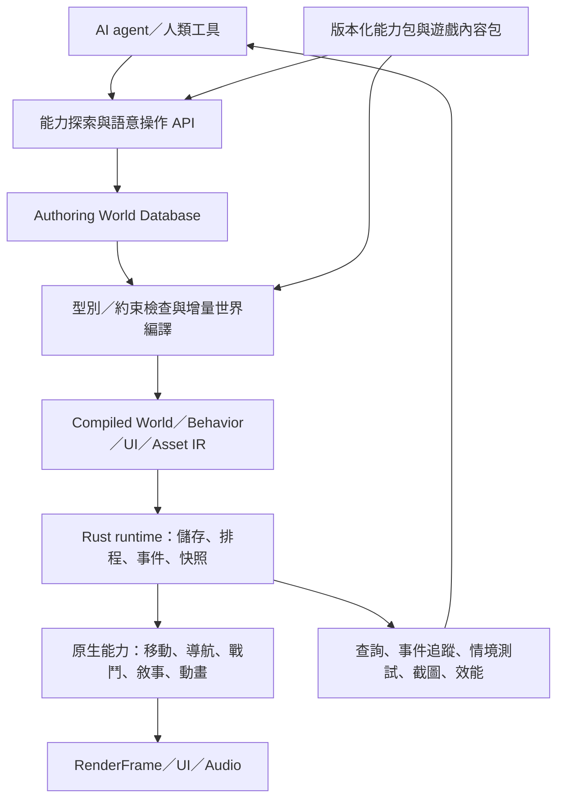

# Axiom：AI-first 通用遊戲引擎演進規劃

狀態：M0、M1、M1.5 與 M2 的實作見 [M0](m0-implementation.md)、[M1](m1-implementation.md)、[M1.5](m15-implementation.md) 與 [M2](m2-implementation.md)。Action 內容包與能力時序見 [M3](m3-action.zh-TW.md)，版本化內容組合與聯合作戰關卡見 [M4](m4-composition.zh-TW.md)。能力、實測及限制以實作說明與 artifacts 報告為準。

## 1. 產品目標與完成定義

讓外部 AI agent 能以探索能力、組合內容、修改規則、執行測試的方式，製作不同類型遊戲。Rust 負責原生系統與執行效能，World IR 保存內容與規則，AI agent 負責設計與迭代。

第一個「通用」目標範圍是單機、桌面、小型到中型的 2D／3D 遊戲：FPS、劇情／互動冒險 ADV、RTS、第三人稱 Action。先驗證可組合的能力，不承諾涵蓋所有遊戲類型、商業編輯器、多人同步或大型開放世界。

驗收必須同時滿足：

1. 同一份引擎執行檔可載入四種遊戲內容包，切換遊戲不重新編譯。
2. 已支援能力範圍內，AI 能用資料建立單位、對話、任務、技能與勝敗規則。
3. 新增遊戲內容不用改引擎核心；新增原生演算法仍允許修改 Rust 並重新建置。
4. AI 能取得修改差異、錯誤原因、測試結果與執行版本，並安全重試。
5. 新能力加入後，原本 FPS 的玩法與測試持續成立。

AI 開發代理與遊戲內 NPC 決策分屬不同需求。一般 NPC 先使用有界的規則與原生系統；引擎不要求每幀呼叫 LLM，也不依賴特定模型供應商。

## 2. v0.1 基線與演進方向（M0 前）

| v0.1 位置 | v0.1 設計 | 演進方向 |
|---|---|---|
| `axiom-core/src/ir.rs::World` | 必須有 arena、player、weapon、enemies | 通用 entity／component／relation、世界資源、場景與能力依賴 |
| `World::compile` | 直接展開 fps.player、fps.sentinel | 編譯已註冊的 component schema 與 prefab，產生執行資料及依賴表 |
| `State`／`Condition` | idle／chase／attack／dead 與距離／生命 | 型別化事件、條件、動作；狀態機、敘事圖與技能時序共用底層指令 |
| `protocol.rs::Edit` | 固定 FPS 欄位白名單與 make_arena | 依能力註冊 schema、通用原子編輯與可重用內容配方 |
| `simulation.rs::Simulation` | 同一迴圈處理玩家、槍械與敵人 | 通用世界執行器、系統排程與獨立能力模組 |
| `render.rs`／`ui.rs` | 直接讀 Simulation，產生競技場、槍與 FPS HUD | 從 RenderFrame／UI 資料與資產 handles 繪製，FPS 外觀移入內容包 |
| SQLite／版本／loopback bridge | 已有交易、CAS、歷史、觀察與基本測試 | 保留基礎，補上查詢、編譯診斷、啟用確認、存檔與測試情境 |

保留 winit、wgpu、glam、Rapier 與現有交易模型；持續不使用 Bevy。通用化以可執行的小步遷移進行。

## 3. 目標架構

能力包提供 schema、行為 primitives、編譯器／系統、診斷與測試。遊戲內容包組合 prefabs、規則、UI、資產與關卡。FPS、RTS、ADV、Action 是內容配方與能力組合；核心執行流程不增加 `match genre` 分支。

目前使用 core、fps、rts、runtime、cli 五個 crate，在 crate 內維持清楚的模組邊界；等介面穩定，再按原生依賴與編譯需求評估拆出 renderer、assets、behavior 等 crate。

## 4. 六個核心投資方向

### 4.1 World IR v2：有型別的世界資料模型

世界根節點規劃包含：schema version、能力依賴、entities、prefabs、relations、resources、scenes、rules、UI 與 asset references。世界可以沒有玩家、生命值或物理世界，也可有多個玩家控制上下文。

通用元素：

- Entity：穩定的 authoring ID；runtime 使用有 generation 的短 ID，兩者透過映射連結。
- Component：具版本的 schema，定義欄位型別、預設值、限制、單位與熱更新策略。
- Relation：例如 owner、faction、target、parent、quest giver；可驗證指向對象、基數與禁止的循環。
- Resource：世界時鐘、故事旗標、陣營資源、任務狀態、物品及技能定義。
- Prefab：組件與關係的可重用範本；第一版採單層覆寫並明確記錄來源。
- Scene：實體集合、載入邊界、出生點與進出條件。

Authoring 可使用有 schema 的結構化資料；編譯後將欄位參照解決成 type IDs、storage IDs 與 offsets。每幀執行不查 JSON 字串路徑。第一版保留現有 actor SoA，逐步增加註冊式的 typed column storage；通用 archetype ECS 的複雜度待實測需求成立後再承擔。

資料定義的 component 可新增已支援的 bool、integer、float、enum、entity ref 等欄位，以及使用這些欄位的規則。全新的碰撞、導航或動畫演算法仍需原生能力。

### 4.2 Runtime：系統與資料分離

建立明確的系統階段：收集輸入／命令 → 套用已準備好的世界變更 → 決策與行為 → 移動／物理／戰鬥 → 事件與狀態提交 → 抽取呈現與觀察資料。

每個系統宣告讀寫的 component／resource、事件依賴、更新頻率與執行預算。第一版先採可重現的單執行緒排程；讀寫衝突規則穩定後再評估平行化。

保留現有 FPS 的 120 Hz 基準作遷移起點，讓系統可使用固定倍數頻率。RTS 決策與移動可以較低頻率更新，ADV 主要依事件推進；畫面更新透過呈現快照與插值獨立處理。頻率設定必須由測試及實際 profiling 決定。

玩家輸入映射為 Action／Intent，例如 move、interact、choose、issue_order、use_ability。測試工具與玩家控制器走相同的玩法命令路徑。

### 4.3 Behavior IR v2：共用執行底座，保留不同語意

共用的基礎指令包括：讀寫型別欄位、條件判斷、發出事件、等待時間／事件、呼叫已註冊能力、建立／取消任務。編譯時檢查型別、引用與控制流程；執行時限制指令數、任務數、事件數與每步推進量。

在這個底座上提供三種第一級表示：

| 表示 | 適合描述 | 需要保留的語意 |
|---|---|---|
| 狀態機／任務圖 | NPC、單位命令、互動流程 | 進入／離開動作、取消、失敗、逾時與重入 |
| 敘事圖 | 對話、調查、任務與分支 | 條件選項、旗標、可達性、存檔位置與結局 |
| Ability／Timeline | 攻擊、翻滾、技能與連段 | 前搖、判定、後搖、取消窗、冷卻與事件觸發 |

新增動作必須提供輸入／輸出型別、效果、失敗原因、可用階段與預算。先支援有界、受型別檢查的常見玩法；複雜擴充可後續評估 WASM，不在第一階段引入任意腳本執行。

### 4.4 能力包：跨玩法共用

| 能力包 | 提供的主要能力 | 使用者 |
|---|---|---|
| spatial／presentation | Transform、Camera、Mesh／Sprite、Light、UI bindings | 全部 |
| interaction | 點選、射線互動、範圍觸發、互動選單 | FPS、ADV、Action；RTS 選取可共用 picking |
| character／navigation | 角色控制、移動任務、路徑請求、局部避障 | FPS、RTS、Action |
| attributes／combat | 生命、資源、傷害、陣營、技能與效果 | FPS、RTS、Action |
| narrative／quests | 故事旗標、物品條件、對話、任務、結局 | ADV，也可用於 Action 與 RTS 劇情 |
| economy／orders | 資源、佇列、建造、生產、群組命令 | RTS，也可用於經營或策略玩法 |
| animation | 骨架、clip、blend、時序事件、角色呈現 | Action、FPS、RTS |

每包有 manifest：版本、依賴、component schemas、actions、events、constraints、runtime systems、hot reload policies 與情境測試。依賴不相容、循環或缺失，在世界編譯階段回報。

### 4.5 呈現與資產：讓內容也能由 AI 改

Renderer 改為接收 RenderFrame，包含 camera views、mesh／sprite instances、materials、lights 與 overlays。`Renderer::render` 不再接收 FPS Simulation。槍械視角模型、競技場與敵人外觀改由內容資料產生。

UI 使用元件樹與資料綁定，將點擊送成玩法命令。共用文字、圖片、按鈕、列表、進度條、版面與 picking，分別組合 FPS HUD、RTS 資源列與 ADV 對話選項。ADV 的基礎版本須涵蓋中文字型、換行與基本本地化。

資產採穩定 asset ID、型別、匯入設定、來源／衍生檔關係與依賴追蹤。先支援圖片、字型、基本 mesh／material，再加入 glTF 模型、骨架動畫及音訊。缺少資產有明確診斷與 placeholder；資產替換應只重建受影響的衍生資料。

### 4.6 AI 工作流程：讓修改可預測、失敗可診斷

保留 schema／query／apply／verify／observe／undo 的入口，規劃擴充：

| 能力 | AI 得到什麼 |
|---|---|
| 小型能力索引、按需 schema | 只讀當前任務需要的型別、動作、例子與限制 |
| 有型別 selector 與欄位投影 | 批次選取單位、故事節點或資產，限制回傳量 |
| preview／dry run | 預計差異、引用破壞、資源成本、重啟需求與診斷 |
| 原子 apply、CAS、request ID／idempotency key | 可偵測衝突，逾時重試不重複建立物件 |
| 增量 observe 與游標 | 回傳指定 tick／revision 之後的事件與變更，避免反覆讀整個世界 |
| explain | 追蹤規則、狀態轉移、路徑失敗、技能拒絕或對話選項被隱藏的原因 |
| 情境測試與局部回放 | 用相同初始狀態與輸入重現問題，回傳失敗前的最短相關事件片段 |

自然語言由外部 agent 轉成具型別的設計計畫與編輯；引擎負責確定性的檢查、編譯與執行。能力缺失應回報 missing capability，讓 agent 判斷採用現有 primitives、安裝相容能力包或新增 Rust 系統。

語意層可提供可重用 recipe，例如「建立採集流程」或「建立條件式對話」，展開成相同的通用原子編輯；展開結果可預覽及追蹤來源。

## 5. 三類遊戲如何落地

### ADV：先證明世界不需要槍械、敵人或物理

第一個原型以劇情／互動冒險為範圍，包含兩個角色、兩個場景、一個可調查物件、一件關鍵物品與三種結局。支援對話選項、條件、旗標、場景切換及存讀檔；同一份敘事規則可由視覺小說介面或 3D 互動觸發。

AI 驗收任務：「取得鑰匙才顯示開門選項；拒絕協助會進入另一個結局。」修改後不重編譯，測試可檢查選項條件、三個結局的可達性、斷掉的節點引用與讀檔後的條件狀態。可達性檢查須有狀態空間與搜尋預算；超出預算明確回報未完成證明。

### RTS：證明多角色與批次命令成立

第一個原型包含俯視相機、框選、右鍵移動／攻擊、兩個陣營、資源點、採集、單一生產建築與勝敗規則。第一個功能驗收場景使用雙方各 32 個單位，另設 128／256 個單位的獨立壓力測試；不預先承諾 FPS。

先採明確的平面格網導航與共享路徑／命令服務，提供有限的編隊與局部避障。導航任務有排隊、快取、預算、取消及無路徑結果；大型群組不逐幀為每單位重算路徑。單位碰撞可先使用平面 footprint 與空間索引，不要求每個單位都跑高成本剛體模擬。

AI 驗收任務：「礦工滿載後回基地，交付後繼續採集；建築以資源生產士兵。」測試資源守恆、生產扣款、阻路／無路徑診斷、命令替換、陣營過濾及群組抵達情況。

### Action：證明時間、動畫與角色能力成立

第一個原型包含第三人稱相機、鎖定、三段連擊、翻滾、體力、近戰敵人與基礎動畫。保留灰盒驗證，但對「動畫驅動的 Action 能力完成」的驗收須包含實際 clip 匯入與時序事件。

Ability IR 描述前搖、有效判定、後搖、取消窗、體力消耗、無敵窗與冷卻。輸入緩衝與動畫事件使用模擬時序；同一次攻擊對同一目標的命中策略必須明確。

AI 驗收任務：「第二段攻擊可接翻滾；翻滾前半段無敵；體力不足時不能使用。」測試時序邊界、重複傷害、取消、輸入緩衝與不同畫面更新率下的玩法結果。

## 6. 建議里程碑與驗收門檻

以下版本編號僅為路線規劃；依通過驗收門檻推進，不設定尚未估算的日程。

| 里程碑 | 主要交付 | 放行條件 |
|---|---|---|
| M0／v0.2：抽出 FPS | 通用 World IR v2、registry、基本系統排程、呈現介面、v1 遷移 adapter、FPS 內容包 | 沒有 player／weapon 的空世界可載入；舊 FPS 通過原測試與 GPU 回歸；renderer 不引用 FPS Simulation |
| M1／v0.3：ADV 與 AI 閉環 | 事件／條件／動作、Narrative IR、UI／字型／圖片、存檔、preview、情境 runner | 三個結局可測；AI 只改資料完成分支任務；存讀檔及錯誤引用驗證通過 |
| M1.5：AI 操作與量測 | 穩定 ID 局部查詢／編輯、精確 diff／診斷、增量 observe、冪等重試、外部 agent benchmark | FPS／ADV 資料任務有獨立驗收；快取、游標及重試邊界可測；未知模型 usage 不宣稱 token 節省 |
| M2／v0.4：RTS | picking、群組命令、平面導航、資源／生產、較低頻決策與觀察投影 | 64 單位功能場景完成；128／256 壓測有實測報告；既有 FPS／ADV 回歸通過 |
| M3／v0.5：Action | 基礎模型／骨架動畫管線、Ability IR、timeline、第三人稱控制、音訊事件 | 連擊／翻滾原型完成；時序、動畫與資產替換測試通過；前三類回歸通過 |
| M4／v0.6：組合驗收 | 相依版本鎖定、跨包事件／資源契約、AI 任務基準 | 同一關卡含 RTS 小隊、Action 英雄與 ADV 任務；切換或組合內容包不修改核心原始碼 |

資產／UI、診斷與情境測試從 M0 開始，按各里程碑需求擴充。完整視覺編輯器、大型 ECS 重寫、任意腳本、多人網路與 GPU-driven rendering 暫不成為前置條件。

## 7. 版本、熱更新與存檔的一致性

必須分開紀錄三種版本：authoring revision、runtime applied revision、save/checkpoint version。

- 世界定義 undo 只恢復 authoring 內容；戰鬥或敘事進度的回復由 checkpoint／save 控制。
- 編輯成功 commit 與 runtime 成功啟用分開回報。新 revision 準備資產或 storage 失敗時，執行器保留上一個可用世界，回報 activation_failed 與診斷。
- Component 欄位宣告熱更新策略：直接保留／重算／重建／要求重新開始／拒絕執行中更改。AI 可在 preview 看見影響。
- 新格式可讀取舊 revision，再透過版本化 adapter 轉成新 IR；還原舊世界不回退 SQLite 實體 schema。
- 存檔以穩定 entity／node／asset IDs 參照內容；內容包升級要有遷移或明確的不相容診斷。

SQLite 的正規化採漸進方式：先保留 immutable revision 快照，加入編譯後的查詢投影與依賴索引；待查詢成本與變更需求證明有必要，再遷移為實體／組件／關係表及 patch log。維持單一可追溯的真實來源。

## 8. 自動驗證與 AI-first 指標

Scenario IR 保存：內容版本、初始 runtime 狀態、seed、輸入命令／事件、執行 tick、斷言、超時與預算。輸出結構化結果、失敗的 entity／rule IDs、相關 trace，以及按需的截圖與 profiler artifacts。

| 範圍 | 要驗證的內容 |
|---|---|
| 核心 | 引用、型別、預算、原子性、CAS、重試冪等性、遷移、熱更新與啟用失敗 |
| FPS | 移動、碰撞、遮擋、射擊、裝填與敵人 |
| ADV | 選項、物品／旗標條件、結局、場景與存讀檔 |
| RTS | 選取、命令、路徑、資源、生產與勝敗 |
| Action | 連段、取消窗、無敵、體力、命中與動畫事件 |
| 跨能力 | 同一事件的消費順序、共享資源語意、能力包版本與組合 |

重現性先限定同一引擎 build／平台、固定 seed 與輸入。跨平台浮點物理、多人 RTS lockstep 與 bit-exact 重播需要額外工程，不由固定步進自動保證。

AI 基準採固定任務集，記錄實際模型 tokens、工具呼叫數、首輪／最終成功率、人工修正次數、修改到驗證的時間及引擎重建次數。模型與環境必須固定，冷啟動與暖快取分開；serialized bytes 只作 payload 指標，不當作 token 數。

Runtime 分開測 CPU 更新、GPU timestamps（工具支援後）、frame time 分位數、RAM 與資產記憶體，註明硬體、build profile、場景、數量與採樣方法。現有 frame_ms_cpu 包含提交／等待與擷取成本，不能當作純 CPU 或 GPU 執行時間。

## 9. M0 啟動時的工作拆解（歷史規劃）

以下保留 M0 的初始工作拆解；目前已加入 RTS 與 AI 操作合約，後續工作依第 6 節的 M3／M4 驗收門檻推進。

1. 定義 ADR 與 World IR v2 最小 schema：entities、typed components、resources、relations、能力依賴；完成 v1 FPS 轉換與 round-trip／undo 測試。
2. 建立 component／system registry 與最低限度儲存。先移植 Transform、RenderMesh、Camera、Collider、Health；讓空世界、無生命的物件與多相機世界可編譯。
3. 建立通用 WorldRuntime 與 ActionMap，將玩家控制、射擊與敵人系統搬入 FPS 能力模組；保留現有 FPS 的固定步進與碰撞行為。
4. Renderer／UI 改讀呈現快照，競技場、槍械、敵人與 HUD 由 FPS 內容包提供；加入空世界、雙相機與 FPS 的 GPU smoke。
5. 註冊式 schema／query／apply 接入現有交易，加入 dry run、結構化診斷、runtime 啟用狀態與一個完整 scenario；將 FPS 資料編輯任務納入回歸。

M0 的完成證據是「FPS 作為內容包仍可玩，而且沒有 FPS 元件的世界也可載入、觀察與驗證」。M1 再以 ADV 實際證明非 FPS 的遊戲規則與 UI 能完全走同一套 AI 開發流程。
